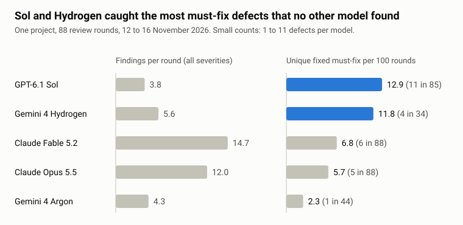

# What I noticed in 3,000 findings from five AI code reviewers

Since Opus 5.5, I had a feeling that the other AI reviewers in my workflow rarely find anything important. I asked agents to collect statistics from one working session to check it. These are notes from my own setup: one project, five days, one author.

## The session

When a change is ready, I start a fresh review in three CLI tools, fix what looks important and often run a second round. The project is an internal Python tool with a lot of documentation logic. In this session, five models took part:

- Claude Opus 5.5 and Claude Fable 5.2 in Claude Code, 88 rounds each
- GPT-6.1 Sol in Codex CLI, 85 rounds
- Gemini 4 Argon in Antigravity CLI, 44 rounds
- Gemini 4 Hydrogen (High) in Antigravity CLI, 34 rounds

Google released Hydrogen on 12 November, in the middle of the session, so I switched from Argon to Hydrogen. The two Gemini models never reviewed the same change.

In five days this gave 48 merge requests, 88 review rounds and 3,072 findings. Agents grouped the findings into 1,809 defects. A defect here is one problem in one round, reported by one or more models. The agents also traced in the transcript what happened to each defect: I fixed 1,345, decided not to follow 56, 77 turned out to be wrong, and 331 stayed unclear.

## What I noticed

The first surprise was how little the reviewers repeat each other. Of the 1,345 defects I fixed, 650 (48%) came from only one reviewer. Even Fable 5.2, which found the most, reported 70% of them. I expected the overlap to be much larger.

Opus and Fable, on the other hand, often say the same thing. They share 694 defects. Still, together they missed 161 defects that I fixed, and 19 of those were must-fix.

The quietest reviewer turned out to be the most interesting. Sol writes short reviews: 3.8 findings per round, against 14.7 for Fable. It gives almost no nits, mostly must-fix and should-fix. In 27 cases only one model found a must-fix defect that I then fixed, and in 11 of them that model was Sol. For example, it was the only one to see that file symlinks were followed, so the documentation index could read files outside the configured folder. This is the opposite of what I felt before the count.

The Gemini models were harder to judge. Argon hit its quota twice, and some of its reviews started with long tool narration before the actual findings. Hydrogen joined late and ran in only 34 rounds.

Per round, Sol and Hydrogen each found about twice as many must-fix defects that no other model reported, compared with Opus or Fable. For Hydrogen this is only 4 defects, so I would not read much into it yet.

Precision did not tell me much. I fixed 91% to 98% of the findings from each model, counting only defects with a known outcome. Most "wrong" findings from Opus and Fable were questions where the model could not check something and asked me to confirm it.

The second round was not much quieter than the first. First rounds found 22.1 defects per round, second rounds 18.6. Part of this is new code from the fixes, but I expected a bigger drop.

## Why I would not generalize

This is not a model comparison. Claude wrote the code and decided what to fix, and Claude agents grouped the findings and traced the outcomes. If there is a bias, it favours Opus and Fable.

It is also one Python project with a lot of documentation logic, and another codebase can give a different picture. The severity labels come from the reviewers themselves, 18% of the defects have no clear outcome, and I did not count cost or time per round.

## Where this leaves me

My feeling about Opus 5.5 was half right. Opus and Fable do find most of the problems, and a lot of what the other reviewers say is repetition. But in this session, the serious problems that nobody else noticed came more often from the quieter reviewers. The total number of findings and the precision told me almost nothing about that.

For my own setup, the two Claude models give a good base. Together they found 88% of the defects I later fixed, and 90% of the fixed must-fix defects. But they missed 19 must-fix defects, and Sol caught 14 of them. With Sol, the coverage grows to 93% of all fixed defects and 97% of the fixed must-fix. So Claude stays my base, and Sol is a second opinion that is worth running.

Gemini added fewer important defects. Hydrogen caught 5 must-fix defects that both Claude models missed (some of them Sol found too), in 34 rounds. Argon caught 3 in 44 rounds. Per round, Hydrogen is close to Sol, but 5 defects are too few for me to judge it yet.
